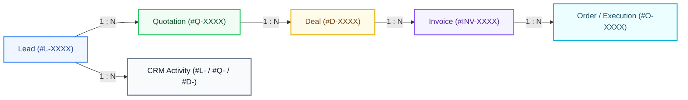

# Business Performance & Revenue Analytics Dashboard

> **Internship Recruitment Assignment**  
> **Submission Deadline:** 19 October 2026, 11:59 PM  
> **Deployment Status:** Not deployed yet _(Deployment URL placeholder: `https://get-manish.github.io/secure-reagent-assignment/`)_

An executive administrative dashboard built with React 19, Tailwind CSS v4, and Recharts to monitor business performance across leads, quotations, deals, operational orders, and revenue in real time.

---

## 1. Project Overview

This project was developed as an **internship recruitment technical assignment**. The assignment brief calls for an interactive administrative analytics dashboard designed to monitor and evaluate business health.

As specified in the assignment brief, the application operates entirely on **deterministic dummy data** served through an asynchronous mock API layer with simulated network latency. There is **no production backend or persistent database required or implemented**.

---

## 2. Assignment Objectives

The primary objective is to provide executive and operational visibility across the end-to-end business pipeline:

- **Lead Generation & Acquisition:** Track incoming lead velocity, qualification rates, channel efficiency, and sales funnel drop-offs.
- **Quotation Pipeline:** Monitor quotations issued by service category, quotation values, proposal status, and quote-to-deal conversion ratios.
- **Deals & Revenue Realization:** Track deal creation volume, high/medium/low priority segmentation, closed revenue, cash collections, and monthly revenue target achievement.
- **Operations & Fulfillment:** Track service order updates, workflow stage progress (Pending, In Progress, Completed, On Hold), and overdue assignments.
- **Team Accountability & Audit Log:** Review performance metrics by individual sales representatives and operations team members, supported by an audit log of recent CRM activities.

---

## 3. Features & Assignment Requirements

The assignment brief defines the following functional expectations:

| Area                       | Requirements                                                                                                                                                                     |
| -------------------------- | -------------------------------------------------------------------------------------------------------------------------------------------------------------------------------- |
| **Lead Analytics**         | Total, qualified, converted, and unqualified lead counts; conversion rates; 3-stage visual lead funnel; status and channel source trends.                                        |
| **Date Filters**           | Multi-period selector (e.g. October 2026, September 2026, November 2026, Last 30 Days, Last 90 Days, This Quarter, Year to Date).                                                |
| **Period Comparisons**     | Comparison of active period against the preceding equivalent period with percentage changes (`+` / `-`).                                                                         |
| **Dynamic Visualizations** | All KPI cards, line charts, bar charts, donut charts, and data tables must respond dynamically to active filter selections.                                                      |
| **Quotation Analytics**    | Breakdown by service category, quoted pipeline values, service-wise status counts (accepted, pending, rejected), and quote-to-deal conversion rates.                             |
| **Deals & Revenue**        | Dual-axis deals vs. revenue chart, revenue by service category, priority breakdown table, daily revenue trends, total deal value vs. net collections, and collection efficiency. |
| **Operations & Orders**    | Fulfillment order status, stacked stage progress (Pending, In Progress, Completed, On Hold), and team operational updates.                                                       |
| **Data Relationships**     | Conceptual relational data structure: 1 Lead → Multiple Quotations/Deals; 1 Deal → Multiple Orders/Invoices/Payments.                                                            |
| **Drill-Down Views**       | Detail modals for inspecting individual sales and operations team members, as well as specific CRM record references.                                                            |

---

## 4. Implemented Features

Every interactive control and visualization in the application has been implemented and verified:

### Navigation & Header Controls

- **Date Range Selector:** Dynamically filters records across October 2026, September 2026, November 2026, Last 30 Days, Last 90 Days, This Quarter, and Year to Date.
- **User Filter:** Dynamically filters the dashboard by individual sales reps (Nancy Singh, Sneha Choudhary, Tannu Kumari, Rohan Sharma, Pooja Verma) and operations specialists (Gaurav Pant, Srishti Upadhyay, Azam Afaroz, Vikram Malhotra).
- **Department Filter:** Scopes visibility and calculations between All Departments, Sales Team, Operations Team, and Finance.
- **Reset Filters Button:** Automatically appears when non-default filters are active, restoring the default October 2026 baseline in one click.
- **Refresh Action:** Re-queries the asynchronous mock API with animated spinner feedback and confirmation toasts.
- **Export System:** Multi-dataset export modal supporting both formatted CSV and structured JSON for Complete Summary, Sales Performance, Quotation Pipeline, Deals Breakdown, and CRM Activity Logs.

### Key Performance Indicators (KPIs)

- **8 Dynamic Metric Cards:** New Leads, Qualified Leads (with Qualified %), Converted Leads (with Conversion %), Unqualified Leads (with Unqualified %), Conversion Rate %, Quotations Created, Deals Created, and Invoices Generated.
- **Directional Trend Indicators:** Dynamic `TrendingUp` and `TrendingDown` icons with color coding (emerald for positive business impact, rose for negative).
- **Comparison Context:** Dynamic comparison subtitles reflecting the active date window (e.g., _vs. prev 31 days_, _vs. prev 30 days_, _vs. prev quarter_).

### Lead & Revenue Funnels

- **Target Achievement Card:** Tracks monthly revenue goal (₹85,00,000 baseline), realized revenue, percentage achieved, remaining amount, and a visual progress indicator.
- **Lead Funnel:** Geometric funnel showing New Leads (100%), Qualified Leads, and Converted Leads, alongside an Unqualified leads summary card.
- **Daily Lead Trend:** Responsive Recharts multi-line chart tracking daily New, Qualified, and Converted leads with auto-scaled axes.
- **Lead Sources Donut:** Interactive Recharts donut chart with central total lead counter and source channel distribution (Google Ads, Website, Referral, Just Dial, LinkedIn, Direct).

### Quotations & Pipeline

- **Quotations by Service:** Auto-scaling bar chart ranking quote counts across legal and corporate service categories.
- **Quotation Value by Service:** Horizontal tiered bar chart showing cumulative pipeline quotation value.
- **Service Wise Quotation Details Table:** Features instant search filtering, multi-column sorting (Service, Quotes, Amount, Accepted, Pending, Rejected, Conversion Rate), and pagination.
- **Quote-to-Deal Conversion Rate:** Circular radial gauge displaying conversion efficiency (21.5% baseline) and deal-to-quote ratio.

### Deals & Revenue Tracking

- **Deals Created vs. Deal Revenue:** Dual-axis bar chart comparing deal counts (left Y-axis) against revenue in INR (right Y-axis) per service category.
- **Revenue by Service Category:** Progress bars ranking revenue contribution and percentage shares.
- **Priority Breakdown:** Table segmenting deals, revenue, and percentages across High, Medium, and Low priorities.
- **Daily Revenue Trend:** Clustered bar chart comparing daily closed revenue vs. collected cash.
- **Total vs. Collected Revenue:** Executive cards displaying Total Deal Value, Net Collected Revenue, and Collection Efficiency %.

### Team Activity & Operations

- **Sales Team Activity Table:** Searchable, sortable, and paginated table tracking leads, qualifications, conversions, conversion rates, quotes, deals, pipeline value, and closed revenue per representative.
- **Operations Team Activity Table:** Searchable, sortable, and paginated table tracking orders updated, stages completed, pending stages, and overdue orders per operations member.
- **Orders & Stage Progress:** Stacked horizontal status bars detailing execution progress (Pending, In Progress, Completed, On Hold) across active service assignments.
- **Recent CRM Activity Audit Log:** Real-time audit table with search filtering, action category filter (`Lead updated`, `Payment recorded`, `Order created`, `Deal created`, `Quotation created`), pagination, and clickable record references.

### Modals & Dialogs

- **User Performance Modal (`UserModal.jsx`):** Contextual profile dialog displaying key metrics, contact details, deal pipelines, and operational milestone counts for both Sales and Operations team members.
- **CRM Record Modal (`RecordModal.jsx`):** Drill-down dialog for inspecting individual record references (`#L-`, `#Q-`, `#D-`, `#O-`, `#INV-`, `#P-`) with client details, timestamps, financial values, execution notes, and copy-to-clipboard functionality.
- **Export Modal (`ExportModal.jsx`):** Dialog enabling custom dataset selection (5 dataset types) and format toggling (CSV / JSON) with instant browser download.

---

## 5. Visual Reference & Screenshots

The application layout is engineered with a 24-column CSS grid to match the reference design:

| Reference Design | Live Application                                    |
| ---------------- | --------------------------------------------------- |
| `assignment.png` | Fully responsive across Desktop, Tablet, and Mobile |

_Note on Deployment URL:_ The project has not yet been deployed to a public hosting provider. Once deployed, the live URL should be recorded below:

```
Deployment URL: Not deployed yet
```

---

## 6. Technology Stack

| Layer                      | Technology                                         | Purpose                                                    |
| -------------------------- | -------------------------------------------------- | ---------------------------------------------------------- |
| **Core Framework**         | React 19 (`^19.3.1`)                               | UI component architecture and state management             |
| **Build System**           | Vite 8 (`^8.3.4`)                                  | High-performance development server and production bundler |
| **Styling**                | Tailwind CSS v4 (`^4.3.3`) via `@tailwindcss/vite` | Modern utility-first responsive styling system             |
| **Charts & Visualization** | Recharts (`^3.10.1`)                               | Responsive SVG Line, Bar, and Pie/Donut charts             |
| **Icons**                  | Lucide React (`^1.59.0`)                           | Semantic iconography                                       |
| **Animation**              | Motion (`^14.3.0`)                                 | Modal transitions and animated state updates               |
| **Testing**                | Vitest (`^5.0.5`)                                  | Automated unit and integration test runner                 |
| **Code Quality**           | Oxlint (`^1.88.0`)                                 | High-performance JavaScript/React linting                  |
| **Formatting**             | Prettier (`^3.9.10`)                               | Code formatting and style enforcement                      |

---

## 7. Project Structure

```
bpra/
├── .github/
│   └── workflows/
│       └── deploy.yml            # GitHub Actions CI/CD for GitHub Pages deployment
├── public/
│   ├── icon.svg                  # Application favicon
│   └── manifest.json             # Web app manifest configuration
├── scripts/
│   └── generateEntities.js       # Generator script for deterministic seed data
├── src/
│   ├── components/
│   │   ├── ActivityRow.jsx       # Sales & Ops team tables, Orders progress, CRM log
│   │   ├── Card.jsx              # Reusable Card container, SectionTitle, Legend, Avatar
│   │   ├── CountUp.jsx           # Animated numeric counter component
│   │   ├── DealsRow.jsx          # Deals vs revenue chart, priority table, revenue trend
│   │   ├── ExportModal.jsx       # Modal for downloading CSV/JSON exports
│   │   ├── Header.jsx            # Application header, date/user/dept filters, actions
│   │   ├── KpiGrid.jsx           # 8 top-level key performance indicator cards
│   │   ├── LeadRow.jsx           # Target achievement, lead funnel, trend, sources
│   │   ├── QuotationRow.jsx      # Quotation charts, searchable details table, gauge
│   │   ├── RecordModal.jsx       # Detailed CRM entity inspection dialog
│   │   └── UserModal.jsx         # Performance profile dialog for sales & ops members
│   ├── data/
│   │   ├── entities.js           # 500+ relational seed records (leads, quotes, deals, etc.)
│   │   └── mockData.js           # Unified exports and default baseline constants
│   ├── lib/
│   │   └── utils.js              # Formatting (INR currency, dates, CSV export, classes)
│   ├── services/
│   │   ├── __tests__/
│   │   │   └── analyticsEngine.test.js  # Automated tests for metrics & API endpoints
│   │   ├── analyticsEngine.js    # Data aggregation, filtering, and metric calculation
│   │   └── mockApi.js            # Asynchronous mock API endpoints with simulated latency
│   ├── App.jsx                   # Top-level state coordinator and modal container
│   ├── index.css                 # Tailwind CSS v4 directives, fonts, and base styles
│   └── main.jsx                  # React DOM root entry point
├── assignment.png                # Assignment brief visual reference
├── index.html                    # HTML document entry point
├── package.json                  # Dependencies, scripts, and package metadata
├── vite.config.js                # Vite build configuration with Tailwind plugin
└── README.md                     # Project documentation
```

---

## 8. Prerequisites & Installation

### Prerequisites

- **Node.js:** v18.0.0 or higher (v20+ or v22+ recommended)
- **npm:** v9.0.0 or higher

### Local Setup Instructions

1. **Clone the repository:**

   ```bash
   git clone <repository-url>
   cd bpra
   ```

2. **Install dependencies:**

   ```bash
   npm install
   ```

3. **Start the local development server:**

   ```bash
   npm run dev
   ```

4. **Access the application:**  
   Open your browser and navigate to `http://localhost:5173/`.

---

## 9. Available Scripts

The project includes the following scripts defined in `package.json`:

| Command                | Description                                                                                      |
| ---------------------- | ------------------------------------------------------------------------------------------------ |
| `npm run dev`          | Starts the Vite development server with Hot Module Replacement (HMR) at `localhost:5173`.        |
| `npm run build`        | Compiles the production build into the `dist/` directory using Vite.                             |
| `npm run preview`      | Locally serves the production build in `dist/` for verification.                                 |
| `npm run lint`         | Runs `oxlint src` to verify correctness and syntax across all source files.                      |
| `npm run format`       | Runs `prettier --write .` to automatically format all repository files.                          |
| `npm run format:check` | Verifies code formatting compliance against Prettier rules.                                      |
| `npm test`             | Runs the automated test suite using `vitest run`.                                                |
| `npm run check`        | Executes the complete quality pipeline: `npm run format:check && npm run lint && npm run build`. |

---

## 10. Data Model & Conceptual Relationships

The application simulates a corporate CRM and ERP data structure using deterministic fixtures in `src/data/entities.js`:



- **Leads (509 records):** Key attributes include `id`, `leadNumber`, `clientName`, `companyName`, `user` (assigned rep), `service`, `source`, `status` (`new`, `qualified`, `converted`, `unqualified`), `createdAt`, and `estimatedValue`.
- **Quotations (422 records):** Key attributes include `quoteNumber`, `clientName`, `user`, `service`, `amount`, `status` (`accepted`, `pending`, `rejected`), and `createdAt`.
- **Deals (125 records):** Key attributes include `dealNumber`, `user`, `service`, `priority` (`High`, `Medium`, `Low`), `dealValue`, `revenue`, `collectedAmount`, `status` (`won`), and `closedAt`.
- **Invoices (587 records):** Key attributes include `invoiceNumber`, `clientName`, `user`, `service`, `amount`, `status` (`paid`, `pending`), and `createdAt`.
- **Orders (79 records):** Key attributes include `orderNumber`, `service`, `opsUser`, `stages` (`pending`, `inProgress`, `completed`, `onHold`), and `updatedAt`.
- **Activities (122 records):** Key attributes include `id`, `time`, `user`, `action`, `record`, and `details`.

---

## 11. Filtering, Metrics & Calculations

The analytics query engine (`src/services/analyticsEngine.js`) dynamically computes all dashboard outputs from matching records:

1. **Lead Qualification Rate:**
   $$\text{Qualified \%} = \left(\frac{\text{Qualified Leads} + \text{Converted Leads}}{\text{Total Leads}}\right) \times 100$$
2. **Lead Conversion Rate:**
   $$\text{Conversion Rate} = \left(\frac{\text{Converted Leads}}{\text{Total Leads}}\right) \times 100$$
3. **Quote-to-Deal Conversion Rate:**
   $$\text{Quote Conversion \%} = \left(\frac{\text{Deals Created}}{\text{Quotations Created}}\right) \times 100$$
4. **Target Achievement:**
   $$\text{Achieved \%} = \left(\frac{\text{Closed Revenue}}{\text{Monthly Target (₹85,00,000)}}\right) \times 100$$
5. **Collection Efficiency:**
   $$\text{Collection Efficiency \%} = \left(\frac{\text{Net Collected Revenue}}{\text{Total Deal Value}}\right) \times 100$$
6. **Period Comparison Delta:**
   $$\Delta\% = \left(\frac{\text{Current Period Value} - \text{Previous Period Value}}{\text{Previous Period Value}}\right) \times 100$$

---

## 12. Testing & Quality Checks

The codebase is covered by automated verification and linting:

### Automated Unit Tests (`vitest run`)

- **October Baseline Verification:** Confirms exact alignment with reference figures (91 leads, 42 qualified, 16 converted, 49 unqualified, 107 quotes, 23 deals, 142 invoices, ₹1,02,928 achieved, ₹1,82,627 deal value, ₹1,20,698 collected).
- **Date Range Recalculation:** Verifies independent, correct re-aggregation when switching time horizons (September 2026, November 2026, etc.).
- **User Scoping:** Verifies metrics filter to individual representatives when selected.
- **Department Visibility:** Verifies correct scoping when filtering by Operations, Sales, or Finance.
- **Mock API Methods:** Verifies `getFilterOptions()` and `getRecordDetails()` handle queries correctly.

### Quality Commands Executed & Verified

```bash
# 1. Format check
npm run format:check  # All matched files use Prettier code style

# 2. Linting check
npm run lint          # 0 warnings and 0 errors across 19 files

# 3. Production build
npm run build         # Built in ~1.2s, dist/ bundle generated

# 4. Unit tests
npm test              # 6/6 tests passed in 502ms
```

---

## 13. Deployment

The repository includes a GitHub Actions workflow (`.github/workflows/deploy.yml`) configured for automated deployment to GitHub Pages upon pushing to the `main` branch.

### Deploying to GitHub Pages

1. Push the code to a GitHub repository on the `main` branch.
2. In the repository settings, navigate to **Pages** > **Build and deployment**.
3. Under **Source**, select **GitHub Actions**.
4. The workflow will automatically run `npm run lint`, `npm run build`, and deploy the `dist/` directory to GitHub Pages.

### Deploying to Vercel or Netlify

- **Build Command:** `npm run build`
- **Output Directory:** `dist`
- **Install Command:** `npm install`

---

## 14. Assignment Scope & Limitations

- **Internship Context:** This application was developed specifically for an internship technical assessment. It is not affiliated with or endorsed by any specific commercial entity.
- **Frontend Only:** All data is simulated in-memory and generated deterministically. There is no active database, backend REST/GraphQL server, or authentication system.
- **Simulated Latency:** The mock API introduces artificial promise delays (~200ms) to model real-world asynchronous request-response cycles, loading skeletons, and error handling.
- **Custom Calendar Input:** The date filter currently supports standard preset ranges (October 2026, September 2026, November 2026, Last 30 Days, Last 90 Days, This Quarter, Year to Date). Arbitrary arbitrary dual-date pickers can be added as a future enhancement.

---

## 15. Submission Information

- **Assignment Title:** Business Performance & Revenue Analytics Dashboard
- **Deadline:** 19 October 2026, 11:59 PM
- **Submission Requirement:** Publicly accessible deployed URL.
- **Current Deployment Status:**
  ```
  Deployment URL: Not deployed yet
  ```

---

## 16. Future Improvements

- [ ] Connect to a persistent backend database (e.g. PostgreSQL, Supabase, or MongoDB).
- [ ] Add user authentication (OAuth / JWT) with role-based access control (Admin, Sales, Operations).
- [ ] Implement an interactive date range picker calendar for custom date slicing.
- [ ] Support custom CSV/Excel file uploads to allow users to visualize their own CRM data.
- [ ] Enable dark mode / light mode theme toggling.
- [ ] Add automated End-to-End browser tests via Playwright.

---

## 17. License

This project is licensed under the [ISC License](LICENSE) as specified in `package.json`.
